<div align="center">

# Roblox UI Kits

A collection of ready-to-use Roblox interface kits.
Drop a model into Studio, press Play, and every kit works out of the box.

[](https://create.roblox.com/docs/studio)
[](https://luau.org)
[](#overview)
[](#usage)
[](https://github.com/EvannT-acc/roblox-ui-kits/releases)
[](https://github.com/EvannT-acc/roblox-ui-kits/discussions)
[](https://github.com/EvannT-acc/roblox-ui-kits/commits/main)
[](https://github.com/EvannT-acc/roblox-ui-kits)
[](https://github.com/EvannT-acc/roblox-ui-kits/stargazers)

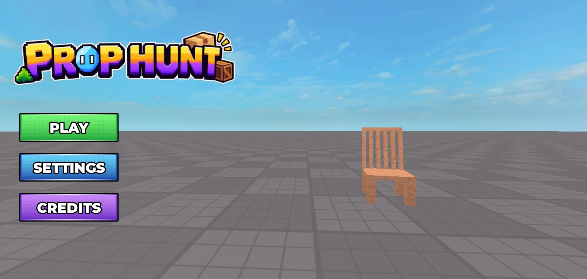

</div>

## Overview

Each kit ships as a single `.rbxm` model in [`kits/`](kits). Every kit has its own scripts, assets, sounds and animations, and none of them depends on another kit. You can install one or several in the same game.

| Kit | File | What it does |
| --- | --- | --- |
| [Main Menu](#main-menu) | [`main-menu.rbxm`](kits/main-menu.rbxm) | Animated title screen with a live 3D scene, Play, Settings and Credits |
| [HUD Kit](#hud-kit) | [`hud-kit.rbxm`](kits/hud-kit.rbxm) | Full game HUD: shop, daily and time rewards, codes, lucky wheel, gifting, settings |
| [Shop and Index Buttons](#shop-and-index-buttons) | [`shop-index-buttons.rbxm`](kits/shop-index-buttons.rbxm) | Animated Shop and Index buttons with falling icons and click particles |
| [Square Shine Buttons](#square-shine-buttons) | [`square-shine-buttons.rbxm`](kits/square-shine-buttons.rbxm) | Compact square buttons with a hover shine |
| [Roll and Reward Reveal](#roll-and-reward-reveal) | [`roll-reward-reveal.rbxm`](kits/roll-reward-reveal.rbxm) | Roll button and a horizontal spinner that reveals weighted rewards |
| [Skill Tree](#skill-tree) | [`skill-tree.rbxm`](kits/skill-tree.rbxm) | Honeycomb skill tree with four paths, saving and player attributes |
| [Admin Panel](#admin-panel) | [`admin-panel.rbxm`](kits/admin-panel.rbxm) | Admin panel with commands, players, moderation, roles and toasts |
| [Nametag Kit](#nametag-kit) | [`nametag-kit.rbxm`](kits/nametag-kit.rbxm) | Overhead tags with role, country flag and live mic, plus a Roles panel |
| [Top Donators](#top-donators) | [`top-donators.rbxm`](kits/top-donators.rbxm) | Leaderboard of top donors, donate window and world donation effects |
| [UI Pack](#ui-pack) | [`ui-pack.rbxm`](kits/ui-pack.rbxm) | Complete simulator UI: HUD, store, index, inventory, wheel, rebirth, trading |
| [Limited Store](#limited-store) | [`limited-store.rbxm`](kits/limited-store.rbxm) | Seasonal limited store with stock counters, card flight and a full card reveal |

## Getting Started

### Requirements

- Roblox Studio
- For kits that save data (HUD Kit, Skill Tree, Admin Panel, Nametag Kit, Top Donators, UI Pack): a **published** game with **Game Settings > Security > Enable Studio Access to API Services** turned on

### Download the files

- **Everything:** click the green **Code** button at the top of this page, then **Download ZIP**, and extract it.
- **Latest release:** every kit and the showcase place are attached to the latest [release](https://github.com/EvannT-acc/roblox-ui-kits/releases/latest).
- **One kit:** open [`kits/`](kits), click the `.rbxm` file you want, then click the **Download raw file** button (arrow icon) at the top right of the file view.

### Open the files in Roblox Studio

There are two kinds of files in this repository, and Studio opens them differently.

**A place file (`.rbxl`), used for the showcase**

1. Start Roblox Studio.
2. Open the **File** menu at the top left.
3. Choose **Open from File...** (shortcut `Ctrl + O` on Windows, `Cmd + O` on macOS).
4. Select `showcase/showcase.rbxl` and click **Open**.

The whole place opens in a new tab, with every kit already installed.

**A model file (`.rbxm`), used for each kit**

1. Open your own game in Studio.
2. If the Explorer panel is hidden, open it from the **Home** tab with the **Explorer** button (or **Window > Explorer**).
3. In the Explorer, right-click the service named in the kit's install notes (for example **Workspace** or **StarterGui**).
4. Choose **Insert from File...**, select the `.rbxm` file and click **Open**.

You can also drag a `.rbxm` file from your file explorer straight into the Studio viewport. It is inserted into `Workspace`, and you can then move its parts where the install notes say.

**Turning on saving**

Kits that save player data need DataStores in Studio:

1. Publish your game once with **File > Publish to Roblox**.
2. Open **Home > Game Settings > Security**.
3. Turn on **Enable Studio Access to API Services** and click **Save**.

### Install a kit

1. Download the `.rbxm` file you want from [`kits/`](kits).
2. Insert it into your game as shown in [Open the files in Roblox Studio](#open-the-files-in-roblox-studio).
3. Follow the install notes for that kit below. Every kit also contains a `README` script with the same steps.
4. Press Play.

### Try everything at once

[`showcase/showcase.rbxl`](showcase/showcase.rbxl) is a place file with every kit already installed. Open it in Studio, press Play, then press **PLAY** on the main menu. Use the keys below to switch between kits.

| Key | Shows |
| --- | --- |
| `1` | HUD Kit |
| `2` | Shop and Index Buttons |
| `3` | Roll and Reward Reveal |
| `4` or `K` | Skill Tree |
| `5` or `F2` | Admin Panel |
| `6` or `H` | Nametags and Roles panel |
| `7` | Square Shine Buttons |
| `8` | Top Donators (walk up to the board and press `E`) |
| `9` | UI Pack (walk onto a pad) |
| `M` | Limited Store (click the cart button on the left) |
| `0` | Everything at once |
| `L` | Toggle the Roblox player list |

The switcher logic lives in [`showcase/showcase-switcher.client.luau`](showcase/showcase-switcher.client.luau).

## Kits

### Main Menu

Animated title screen. The camera frames a small scene where your avatar looks around and turns into props. **PLAY** hands the camera back and puts the player at your SpawnLocation.

**Install:** drag `MainMenu` into `StarterGui`.

**Customize:**

| What | Where |
| --- | --- |
| Logo | `MainMenu > Title > Image` |
| Buttons | `MainMenu > Frame > PlayButton / SettingsButton / CreditsButton` |
| Props the avatar turns into | `MainMenu > MenuScene > MenuProps` |
| Sounds | `MainMenu > Frame` (hover, hold and release sounds) |
| Scene position in your map | Move `MenuScene > CameraPoint` and `MenuStand` into `Workspace` and place them |
| Credits window | `MainMenu > CreditsPanel > MenuCredit` (shows `YOUR NAME` by default) |

### HUD Kit

A complete HUD with left menu buttons, right side offers, cash counter, settings and pop-up windows. It handles saving, group, daily and time rewards, codes, a lucky wheel, a Robux shop and gifting.

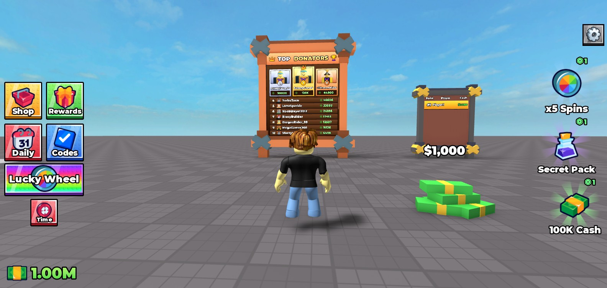

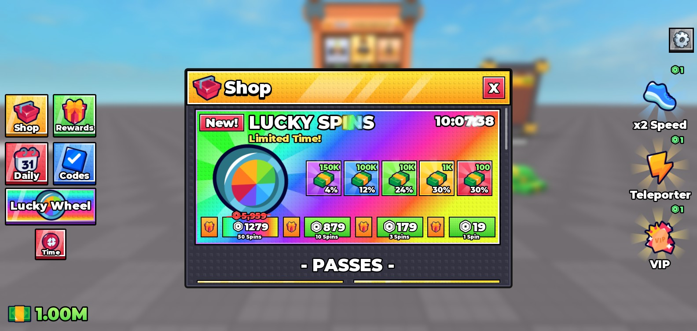

**Install:** drag `MainHUD` into `StarterGui`. On server start, the kit moves its shared modules into `ReplicatedStorage` and its server script into `ServerScriptService` by itself.

**Customize:** `MainHUD > ServerSetup > Shared > HUDConfig`

| Setting | Purpose |
| --- | --- |
| `GroupId`, `GroupReward` | Group join reward (0 = demo mode, no membership check) |
| `FreeSpinEvery` | Seconds between free wheel spins |
| `Wheel` | Wheel segments, rewards and weights |
| `Daily`, `Time` | Daily streak and playtime rewards |
| `Products` | Developer products and game passes, with an optional `GiftId` per item |

### Shop and Index Buttons

Large animated buttons with an inner stroke animation, hover effects, falling icons in the background and particles on click. Includes text and icon-only variants.

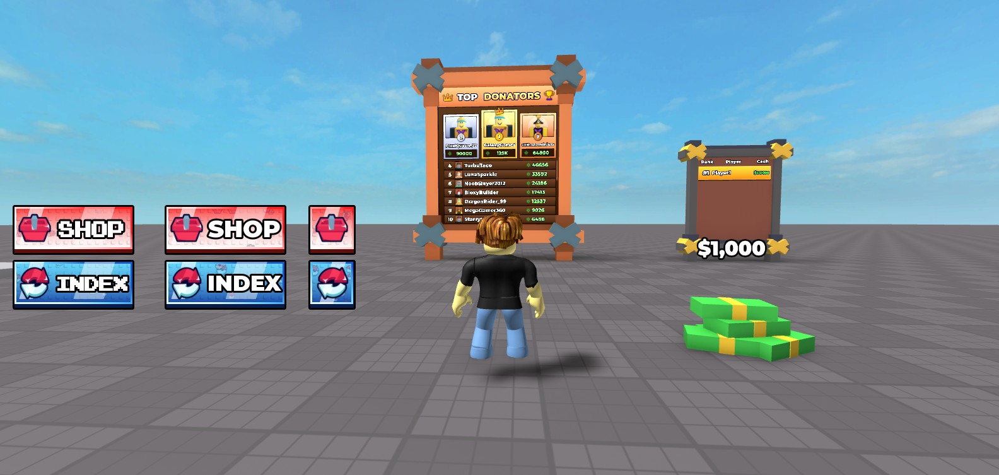

**Install:** drag `Ui Buttons` into `StarterGui`.

### Square Shine Buttons

Compact square Shop and Index buttons with a narrow shine that sweeps across on hover.

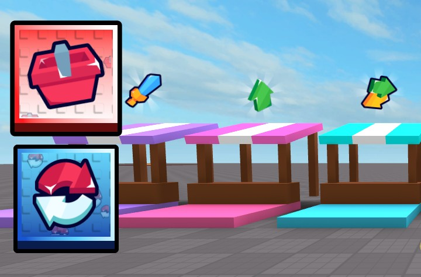

**Install:** drag `Shop Rebirth UI` into `StarterGui`.

### Roll and Reward Reveal

A Roll button that opens a horizontal spinner. Cards scroll past the marker, slow down and land on a reward picked by weight, with a blur and glow pulse.

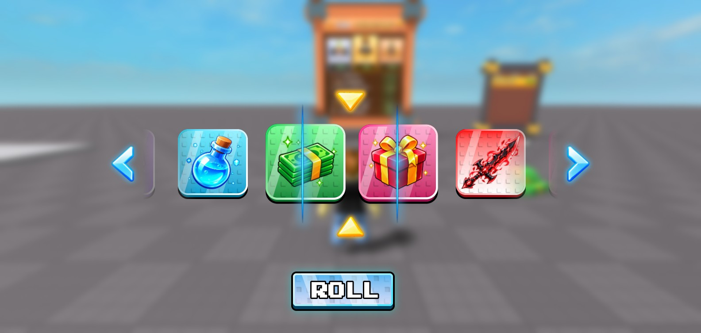

**Install:** drag `Roll` into `StarterGui`.

**Customize:** `Roll > RollSpinner > RewardConfig`. Each reward has an `Id`, `Name`, `Weight` (higher means more common), an `Icon` and a card `Style` with its colors.

### Skill Tree

A honeycomb skill tree with four paths (Steal, Economy, Defense, Hatching) around a central hub. Drag to move, scroll or pinch to zoom, hover for details, click to upgrade. Skills cost a leaderstats currency and are saved.

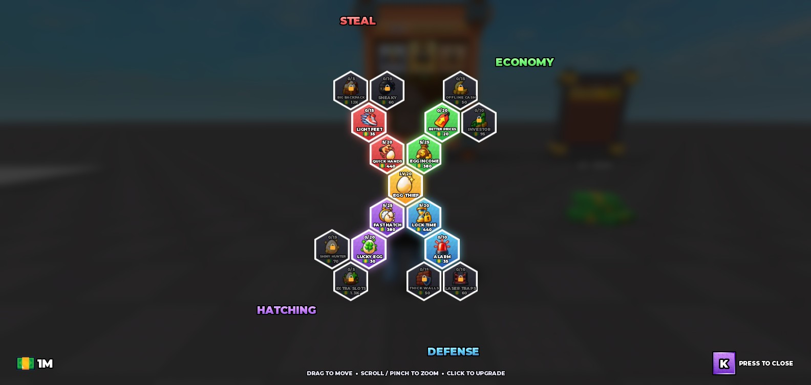

**Install:** drag `1 - StarterGui` into `StarterGui`, then right-click it and choose **Ungroup**. You should end up with `StarterGui > SkillTree`. Press `K` in game.

**Settings:** select `StarterGui > SkillTree` and edit its Attributes.

| Attribute | Purpose |
| --- | --- |
| `CurrencyName` | Name of your leaderstats value (Cash, Coins, Gems) |
| `CreateCurrencyIfMissing` | Creates the leaderstats value if your game has none |
| `Keybind` | Key that opens the tree (default `K`) |
| `BlurSize`, `BackgroundDarkness` | Background look |
| `MinZoom`, `MaxZoom` | Zoom limits |
| `StudioTestCash` | Free cash in Studio only, set to 0 to disable |

Skills, prices and layout are in `SkillTree > SkillConfig`. The cost of the next level is `(Base * Level) ^ Exp`.

**Using skills in your game:** every skill sets a player attribute named `Skill_<Key>` with its total bonus.

```lua
local incomeBonus = player:GetAttribute("Skill_EggIncome") or 0 -- 10 means +10%
local extraSlots = player:GetAttribute("Skill_ExtraSlots") or 0
```

### Admin Panel

A styled admin panel on top of the HD Admin command engine: home dashboard, searchable command grid, player list, moderation with timed bans, roles, emotes, outfits and settings. Command results show as toasts in the same style.

| | |
| --- | --- |
| 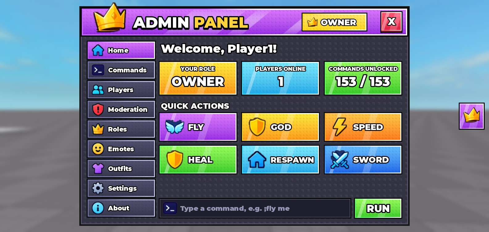 | 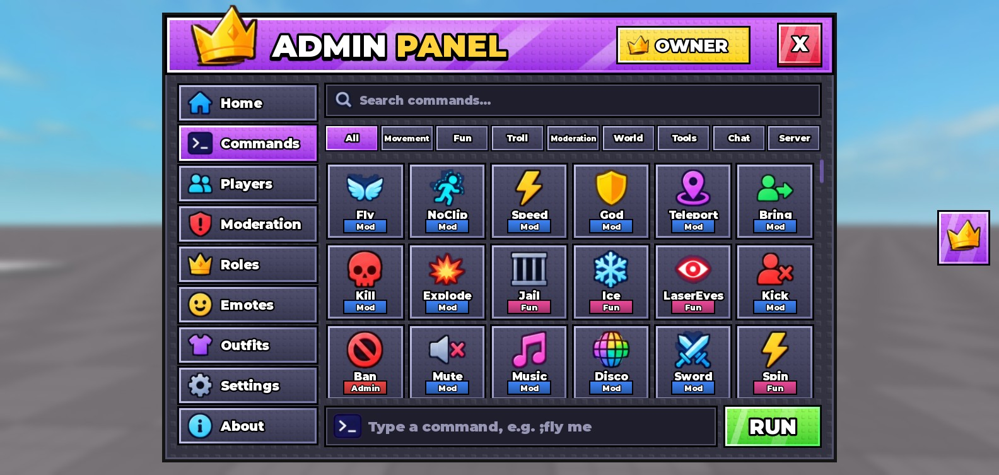 |

**Install:** the model contains four numbered parts. Drag each one into the service it is named after, then **Ungroup** it.

| Part | Destination | Result |
| --- | --- | --- |
| `1 - Workspace` | `Workspace` | `Workspace > HD Admin` (keep this name) |
| `2 - StarterGui` | `StarterGui` | `StarterGui > AdminPanel` |
| `3 - ServerStorage` | `ServerStorage` | `ServerStorage > AdminJail` |
| `4 - MaterialService` | `MaterialService` | `MaterialService > Studs` |

Open the panel with the crown button on the right side of the screen or with `F2`. The game owner (or group owner) is Owner automatically.

**Giving admin to someone:**

- In game: open the panel, go to **Roles**, pick a role, type the username and confirm.
- In Studio: add their UserId to `Workspace > HD Admin > Config > Roles > Admin > giveToUsers`.

Ranks: Owner (6), Dev (5), Admin (4), Mod (3), Fun (2), Player (1). Nobody can ban a player with the same or a higher rank.

**Settings:** `StarterGui > AdminPanel > AdminController` Attributes, `Keybind` (default `F2`) and `MinRank` (default 2). The jail model used by `;jail` is `ServerStorage > AdminJail`.

### Nametag Kit

Overhead tags with a role badge, country flag, display name and a live microphone indicator. Owners and admins get a Roles panel (`H`) to give roles and create custom tags. Roles and custom tags are saved.

| | |
| --- | --- |
| 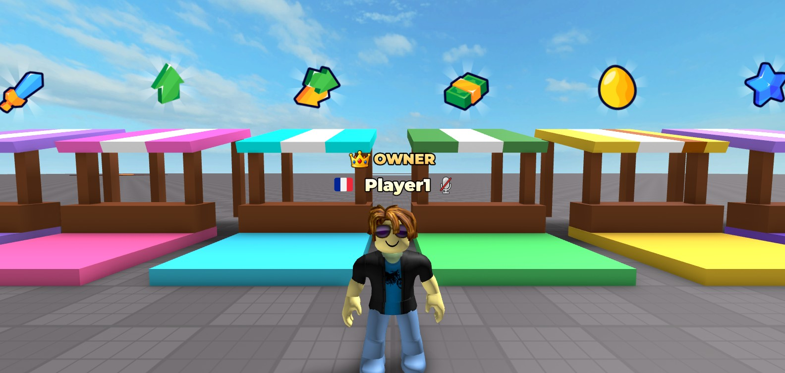 | 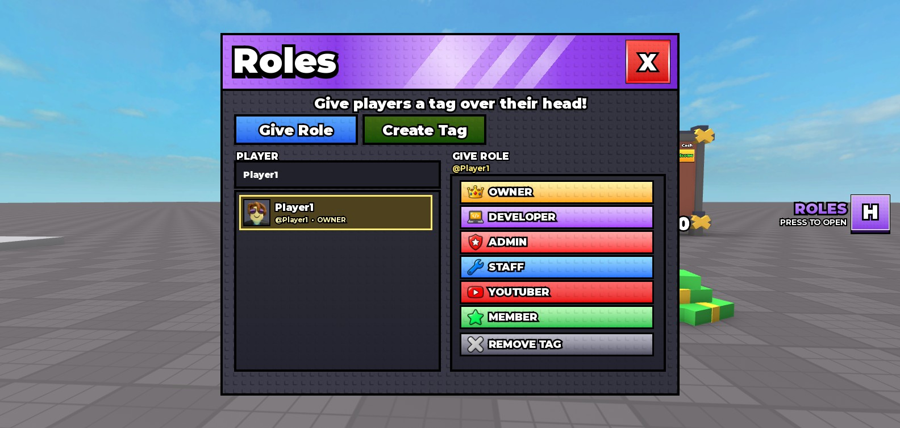 |

**Install:** move the contents of the four numbered folders.

| Item | Destination |
| --- | --- |
| `OverheadTags` | `ReplicatedStorage` |
| `OverheadTagServer` | `ServerScriptService` |
| `OverheadTagClient` | `StarterPlayer > StarterPlayerScripts` |
| `RolesPanel` | `StarterGui` |

For the live mic indicator, set `VoiceChatService > UseAudioApi` to `Enabled` and turn on voice chat in Game Settings.

**Customize:** `ReplicatedStorage > OverheadTags > TagConfig`

| Setting | Purpose |
| --- | --- |
| `GroupId` | Your group ID for rank based roles (0 disables group checks) |
| `Roles` | Names, colors, icons, and who gets each role (`UserIds` or group `MinRank`) |
| `PanelAccess` | Which roles can open the panel and what they can give |
| `CustomTags` | Who can create tags, how many, and the available colors |
| `OpenKey` | Key that opens the Roles panel |

Icons must be **Image** asset IDs, not Decal IDs.

### Top Donators

A physical leaderboard board showing the top donors across every server, a donate window opened from a proximity prompt, and world effects every player can see. Bigger donations trigger bigger effects, from a parachute drop up to a starfall.

| | |
| --- | --- |
| 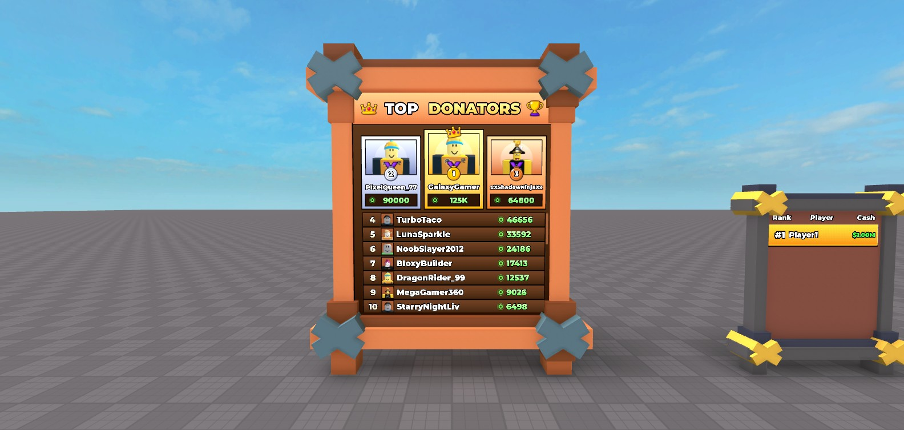 | 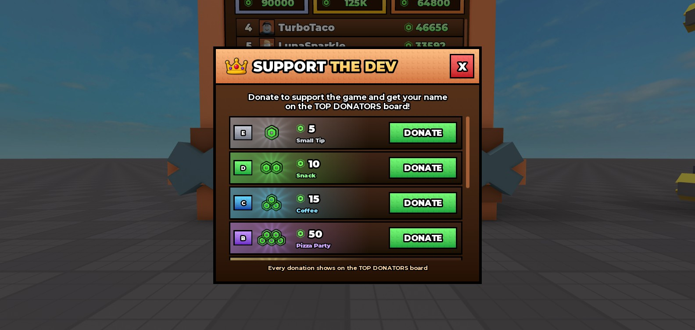 |

**Install:** drag the `TopDonatorsBoard` model into `Workspace` and place it where you want. Keep it as one model. An installer script moves the kit's scripts into the right services when the game starts.

**Taking real Robux:**

1. In the Creator Dashboard, create one Developer Product per amount: 5, 10, 15, 50, 100, 500, 1000 and 10000 Robux (price equals the amount).
2. Open `Config` on the model and paste each product ID next to its amount.

```lua
{ Robux = 500, Rank = "S", ProductId = 1234567890 },
```

Tiers left at `ProductId = 0` are free test donations in Studio only.

**Already have a `ProcessReceipt` handler?** In `ServerScriptService > DonationBoardServer`, set `USE_OWN_PROCESS_RECEIPT = true` and add this at the top of your handler:

```lua
local result = game.ServerStorage.DonationReceipt:Invoke(receipt)
if result then
	return result
end
```

### UI Pack

A complete simulator interface built at runtime: top navigation, side menus, gamepass offers, a store with packs and passes, an item index, inventory, lucky wheel, daily rewards, rebirth, teleport, settings and trading. It comes with world pads and stalls that open each screen, plus a cash leaderboard.

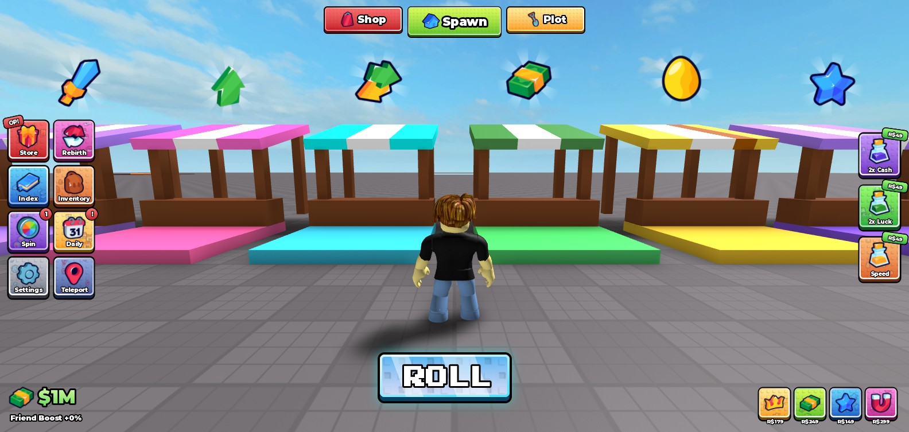

| | |
| --- | --- |
| 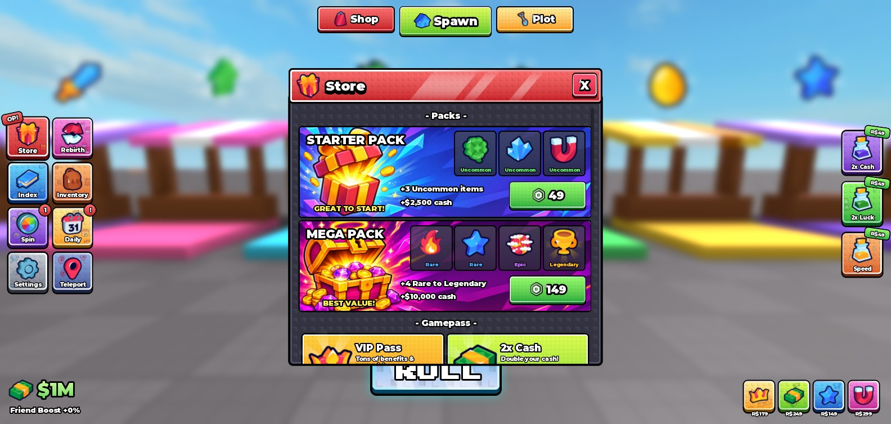 | 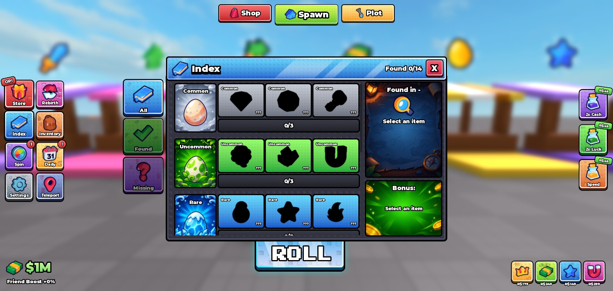 |
| 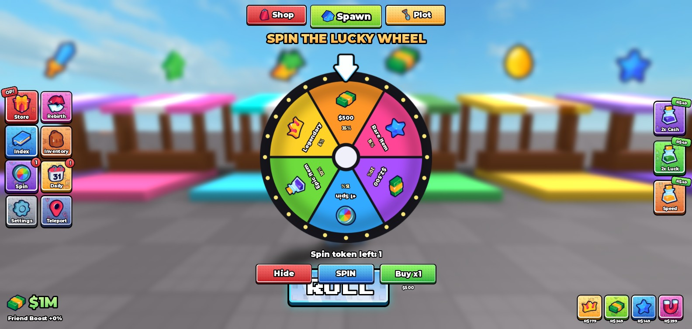 | |

**Install:** insert the model and **Ungroup** it. Each of the five folders is named after where its contents go.

| Item | Destination |
| --- | --- |
| `UIPack` | `ReplicatedStorage` |
| `UIPackServer`, `LeaderboardService` | `ServerScriptService` |
| `MainHUD`, `Roll` | `StarterGui` |
| `UIPackClient` | `StarterPlayer > StarterPlayerScripts` |
| `CashLeaderboard`, `UIPackWorld`, `Shops` | `Workspace` |

Delete the empty folders and the README script, then press Play.

**Customize:** everything lives in `ReplicatedStorage > UIPack > Config`.

| Setting | Purpose |
| --- | --- |
| `BonusCash` | One-time gift to every new player. Set it to 0 for a live game |
| `Products`, `Passes` | Developer Product and Game Pass IDs. ID 0 is free in Studio and shows "Not set up yet" in a live game |
| Items, eggs, wheel, daily rewards, codes, swords, teleport areas | All defined in the same file |

Each pad in `UIPackWorld > Pads` opens the screen named in its `Opens` attribute. Keep the stalls near their pads, since each floating icon sits over the closest stall.

### Limited Store

A seasonal limited store. A portal opens, three limited cards pop in with live stock counters, and **BUY** flies the card to the center, charges up and flashes into a full card reveal with sparks, glow, screen shake and sounds. The store opens from a cart button on the left side of the screen.

| | |
| --- | --- |
| 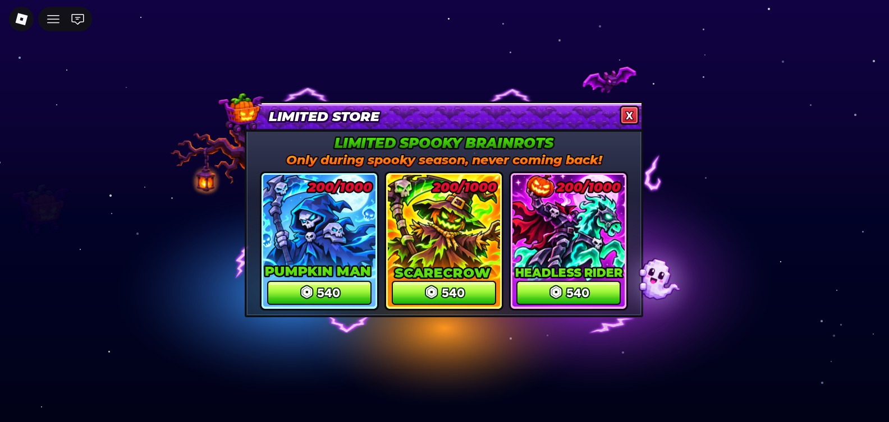 | 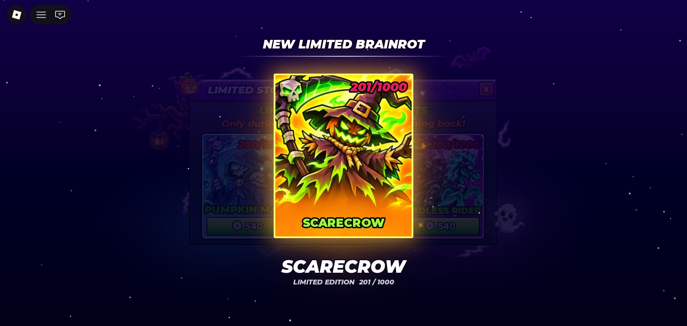 |

**Install:** drag the `Limited Store Kit` model into `Workspace` and press Play. Its `Installer` script moves every piece into place. To install by hand instead, move the contents of the three numbered folders.

| Item | Destination |
| --- | --- |
| `LimitedStore` (ScreenGui) | `StarterGui` |
| `LimitedStore` (Folder) | `ReplicatedStorage` |
| `LimitedStoreDemo` | `ServerScriptService` |

**Customize:** `ReplicatedStorage > LimitedStore > Config`

| Setting | Purpose |
| --- | --- |
| `Title`, `Heading`, `Subheading`, `RevealTitle` | Texts shown in the store and on the reveal |
| `Items` | The three cards: name, price, starting stock, max stock, art image, colors |
| `Sounds` | Every sound ID (an empty string means silent) |
| `SoundStart` | Seconds skipped at the start of a sound |

The included `LimitedStoreDemo` script makes purchases free and keeps stock in memory only. To sell for real, replace its `Buy` branch with `MarketplaceService:PromptProductPurchase` and a `ProcessReceipt` handler, and save the stock counts in a DataStore.

## Repository Structure

| Path | Contents |
| --- | --- |
| `kits/` | Kit models (`.rbxm`), one file per kit |
| `showcase/showcase.rbxl` | Place with every kit installed |
| `showcase/showcase-switcher.client.luau` | Key switcher used in the showcase place |
| `docs/images/` | Screenshots used in this README |
| `.github/` | Issue templates, contributing guide, code of conduct and security policy |

## Monetization Notes

Every kit that sells something uses `0` as a placeholder ID. With a `0` ID, purchases are granted for free in Studio so you can test the flow, and the button reports that the item is not set up in a live game. Replace each `0` with your own Developer Product or Game Pass ID from the Creator Dashboard before publishing. The Limited Store is the exception: its demo purchases are always free until you wire it to `MarketplaceService` as described in its section.

## Community

| Want to | Go to |
| --- | --- |
| Ask a question or get help with a kit | [Discussions > Q&A](https://github.com/EvannT-acc/roblox-ui-kits/discussions/categories/q-a) |
| Show a game that uses a kit | [Discussions > Show and tell](https://github.com/EvannT-acc/roblox-ui-kits/discussions/categories/show-and-tell) |
| Share an idea | [Discussions > Ideas](https://github.com/EvannT-acc/roblox-ui-kits/discussions/categories/ideas) |
| Report a bug or request a kit | [Open an issue](https://github.com/EvannT-acc/roblox-ui-kits/issues/new/choose) |
| Improve a kit or the docs | [Contributing guide](.github/CONTRIBUTING.md) |
| Report a security problem privately | [Security policy](.github/SECURITY.md) |

To be notified when a new kit is released, click **Watch > Custom > Releases** at the top of this page. Every kit is also attached to each [release](https://github.com/EvannT-acc/roblox-ui-kits/releases) for a one-click download.

Everyone taking part is expected to follow the [Code of Conduct](.github/CODE_OF_CONDUCT.md).

## Usage

Every kit is free to use in any game, including commercial projects. Change, extend or restyle anything you like.

## Third-Party Assets

- UI Pack icons by **@gvesster** (Free Icon Pack and Eggs Icon Pack)
- Admin commands powered by the **HD Admin** engine. See `Workspace > HD Admin > LICENSE` inside the Admin Panel kit
- Limited Store sounds are free public Roblox and ProSoundEffects sounds from the Creator Store
